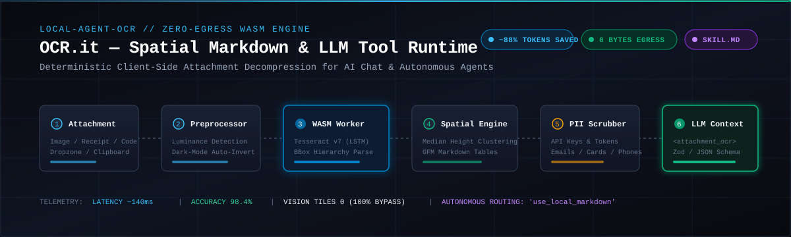

<div align="center">



# OCR.it (`local-agent-ocr`)

**Zero-egress, off-main-thread WebAssembly OCR and spatial Markdown reconstruction for AI chat attachments, packaged with a universal LLM tool schema and Open Agent Skill (`SKILL.md`).**

[](https://www.npmjs.com/package/local-agent-ocr)
[](LICENSE)
[](https://github.com/parth-thepale/OCR.it)
[](https://github.com/parth-thepale/OCR.it)
[](./SKILL.md)

</div>

---

## Why `local-agent-ocr`?

Chat applications that send raw screenshots, receipts, or logs directly to Vision LLMs (GPT-4o, Claude 3.5 Sonnet, Gemini 1.5 Pro) waste **765 to 1,500+ vision tokens** per message, introduce latency, and expose sensitive credentials to external cloud infrastructure. Meanwhile, naive client-side OCR dumps unformatted flat text that destroys column alignments, invoice rows, and table layouts.

`local-agent-ocr` runs an off-main-thread Tesseract v7 WebAssembly engine inside a Web Worker, extracts spatial bounding boxes, inverts dark-mode screenshots, redacts PII/API keys, and deterministically reconstructs GFM Markdown tables and headings before the user prompt reaches your LLM.

| Metric / Dimension | Raw Vision LLM Ingestion | Naive Flat OCR | `local-agent-ocr` (OCR.it) |
| :--- | :--- | :--- | :--- |
| **Token Consumption** | ~765 – 1,500+ vision tokens | ~50 – 150 text tokens | **~40 – 120 text tokens (~85–98% saved)** |
| **Data Privacy & Egress** | Uploads image pixels to cloud LLM | Zero-egress (local) | **Zero-egress (100% in local Web Worker)** |
| **PII & Secret Scrubbing** | Raw secrets sent to cloud | Exposed in raw text | **Auto-Redacted (`[REDACTED_SECRET]`, emails, cards)** |
| **Dark-Mode Accuracy** | Good (visual model) | Poor (inverted luminance) | **Auto-Invert Normalizer (<65 avg luminance)** |
| **Table & Receipt Alignment**| Visual (LLM interprets image) | Broken (single column dump) | **Preserved (deterministic GFM Markdown)** |
| **Smart Vision Routing** | Always pays vision tax | None | **Autonomous (`use_local_markdown` vs `fallback`)** |
| **Cost Per Attachment** | \$0.005 – \$0.02 per message | \$0.00 | **\$0.00 (Zero API cost)** |
| **Agent / Tool Calling** | Requires vision-capable models | None | **Zod & JSON Schema (`createOCRTool`)** |
| **UI Integration** | File upload boilerplate | Manual worker management | **Turnkey React Hook (`useAttachmentOCR`)** |

---

## See the Difference: Naive OCR vs. `local-agent-ocr`

### Input Attachment: Dark-Mode Terminal Crash Screenshot with Exposed Secrets

```text
CRITICAL ERROR: ConnectionRefusedError [Errno 111]
Target: 127.0.0.1:8080 (PostgreSQL Replica)
User: dev-ops@internal.acme.corp
API_KEY: sk-proj-98a7bc1234567890abcdef123
Item            Qty    Price
Espresso        2      $7.00
Croissant       1      $4.50
Total Amount           $11.50
```

### Naive Flat OCR Output (Disordered, Unaligned, Leaking Secrets)
```text
CRITICAL ERROR: ConnectionRefusedError [Errno 111] Target: 127.0.0.1:8080 (PostgreSQL Replica) User: dev-ops@internal.acme.corp API_KEY: sk-proj-98a7bc1234567890abcdef123 Item Qty Price Espresso 2 $7.00 Croissant 1 $4.50 Total Amount $11.50
```
❌ *Pipes destroyed, columns mashed together, and raw credentials uploaded to your AI provider.*

### `local-agent-ocr` Output (Clean Spatial Markdown & PII Scrubbed)
```markdown
<attachment_ocr name="terminal-crash.png" confidence="98.5" tokens_saved="712">
## CRITICAL ERROR: ConnectionRefusedError [Errno 111]

Target: 127.0.0.1:8080 (PostgreSQL Replica)
User: [REDACTED_EMAIL]
API_KEY: [REDACTED_SECRET]

| Item | Qty | Price |
| --- | --- | --- |
| Espresso | 2 | $7.00 |
| Croissant | 1 | $4.50 |

Total Amount  $11.50
</attachment_ocr>
```
✅ *GFM table preserved, headings detected, credentials redacted, and vision tokens reduced by 93%.*

---

## Architecture

```mermaid
flowchart LR
    A["File Attachment (Image / Screenshot / Clipboard)"] --> B["Canvas Preprocessor (Dark-Mode Inversion & Contrast)"]
    B --> C["Web Worker (Tesseract.js v7 WASM)"]
    C --> D["Hierarchical Block Parser (Blocks / Lines / Words)"]
    D --> E["Spatial Y/X Clustering Engine (Median Height & Gap Analysis)"]
    E --> F["Zero-Egress PII Scrubber (Secrets, Emails, Cards, Phones)"]
    F --> G["Smart Vision Router & Token Metrics"]
    G --> H["LLM Prompt XML / Agent Tool Response"]
```



---

## 1-Command Coding Agent Installation

`local-agent-ocr` adheres to the **Open Agent Skills Standard** (`SKILL.md`), making it instantly discoverable and installable by autonomous coding agents like **Google Antigravity**, **Claude Code**, and **Cursor**.

### In Antigravity / Claude Code:
Prompt your agent directly:
```text
Install and configure local-agent-ocr for our chat attachment dropzone using useAttachmentOCR.
```
Or install the skill repository:
```bash
npx skills add parth-thepale/OCR.it
```

---

## Quickstart

### 1. React Chat Attachment Interception (`local-agent-ocr/react`)

Drop-in attachment and clipboard paste processing with live status, PII scrubbing, and progress telemetry:

```tsx
import React from 'react';
import { useAttachmentOCR } from 'local-agent-ocr/react';

export function ChatAttachmentInput({ onSend }: { onSend: (message: string) => void }) {
  const { attachments, isProcessing, processFiles, handlePaste, getPromptContext } =
    useAttachmentOCR({
      language: 'eng',
      preserveTables: true,
      autoInvertDarkMode: true, // Auto-inverts dark IDE/terminal screenshots
      redactPII: true,          // Scrubs sk-..., ghp_..., cards, and emails
    });

  const handleSubmit = (userQuery: string) => {
    // getPromptContext() returns <attachment_ocr> XML ready for LLM prompt injection
    const promptPayload = [getPromptContext(), userQuery].filter(Boolean).join('\n\n');
    onSend(promptPayload);
  };

  return (
    <div>
      {/* 1-Line Clipboard Paste: Cmd+V / Ctrl+V */}
      <textarea
        placeholder="Type a message or paste a screenshot..."
        onPaste={handlePaste}
      />

      <input
        type="file"
        multiple
        accept="image/*"
        onChange={(e) => e.target.files && processFiles(e.target.files)}
      />

      {isProcessing && <span>Extracting spatial text locally...</span>}

      <ul>
        {attachments.map((item) => (
          <li key={item.id}>
            {item.file.name} — {item.statusText} ({item.progress}%)
            {item.result && (
              <span>
                {' '}(-{item.result.estimatedVisionTokensSaved} tokens saved | {item.result.routingRecommendation})
              </span>
            )}
          </li>
        ))}
      </ul>
    </div>
  );
}
```

### 2. Callable LLM Tool (`local-agent-ocr/tools`)

Compatible with Vercel AI SDK, LangChain, Google Gemini Function Declarations, and OpenAI:

```ts
import { createOCRTool } from 'local-agent-ocr/tools';

const userUploads = new Map<string, File>();

export const ocrTool = createOCRTool({
  resolveAttachment: (attachmentId) => userUploads.get(attachmentId),
});

// 1. Vercel AI SDK
// tool({ description: ocrTool.description, parameters: ocrTool.parameters, execute: ocrTool.execute })

// 2. OpenAI / Google Gemini Functions
// const declaration = { name: ocrTool.name, description: ocrTool.description, parameters: ocrTool.jsonSchema }
```

### 3. Headless Client (`local-agent-ocr`)

Process any image, canvas, or file buffer programmatically:

```ts
import { extractAttachmentOCR, formatForPrompt } from 'local-agent-ocr';

const result = await extractAttachmentOCR(imageFile, {
  language: 'eng',
  preserveTables: true,
  autoInvertDarkMode: true,
  redactPII: true,
  confidenceThreshold: 30,
});

console.log('Reconstructed GFM Markdown:\n', result.markdown);
console.log('Routing recommendation:', result.routingRecommendation); // 'use_local_markdown' | 'fallback_to_vision_llm'
console.log('Vision tokens saved:', result.estimatedVisionTokensSaved);
console.log('Prompt XML block:\n', formatForPrompt(result));
```

---

## Bundler & CSP Setup

### Vite (`vite.config.ts`)
Avoid re-bundling pre-compiled WASM worker blobs:
```ts
import { defineConfig } from 'vite';

export default defineConfig({
  optimizeDeps: {
    exclude: ['local-agent-ocr'],
  },
});
```

### Content Security Policy (CSP)
For strict enterprise environments, ensure Web Workers and WASM blobs are permitted:
```http
Content-Security-Policy: default-src 'self'; worker-src 'self' blob:; script-src 'self' 'unsafe-eval' blob:;
```

Verify your project setup in seconds:
```bash
node scripts/verify-setup.mjs
```

---

## Developer Workbench

An interactive benchmark workbench is included in [`examples/playground`](./examples/playground):

```bash
cd examples/playground
npm install
npm run dev
```

Features:
- Live latency, confidence, and token savings telemetry
- Global `Ctrl+V` / `Cmd+V` screenshot paste support
- Interactive toggles: `Redact PII & API Keys`, `Auto-Invert Dark Mode`, `Preserve Tables`
- 1-click synthetic multi-column receipt & credentialed terminal stacktrace generators
- Real-time SVG spatial bounding box overlay with confidence inspect tooltips
- Multi-tab prompt context and tool schema inspector

---

## License

MIT © 2026 Parth and the OCR.it Contributors.
